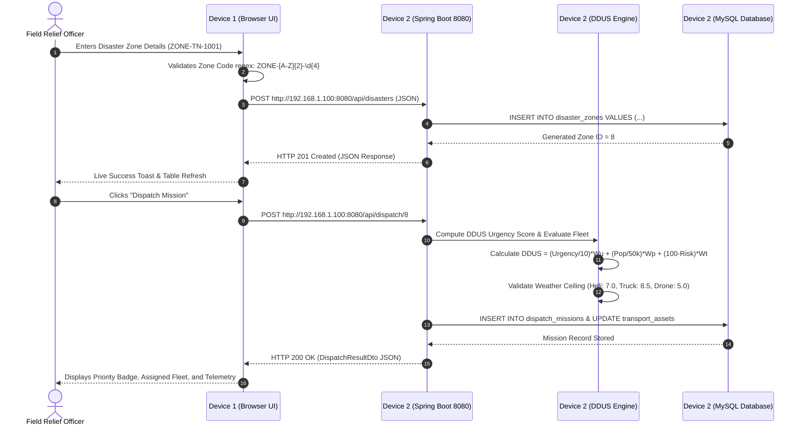

# System Architecture: Two-Device Client–Server Model

**Disaster Relief Supply & Emergency Medical Logistics Dispatch System (DREMLDS)**

---

## 1. Architectural Overview

The DREMLDS platform is engineered using a **Physical Two-Device Client–Server Architecture**. The application is physically split across two independent computers communicating over a shared Local Area Network (Wi-Fi or Ethernet switch) without reliance on any cloud infrastructure, external APIs, or public internet connection.

```
+-----------------------------------------------------------------------------------+
|                              LOCAL AREA NETWORK (WLAN / LAN)                      |
|                               (e.g., 192.168.1.0/24 Subnet)                       |
+-----------------------------------------------------------------------------------+
                  ▲                                                 ▲
                  │ HTTP REST Requests (JSON)                       │ Responses
                  │ GET, POST, PUT, OPTIONS                         │ JSON Data, Reports
                  ▼                                                 ▼
+--------------------------------------+           +--------------------------------+
|       DEVICE 1: FRONTEND CLIENT      |           |    DEVICE 2: BACKEND SERVER    |
|       (Presentation Layer)           |           |   (Application & Data Layer)   |
|                                      |           |                                |
|  - HTML5 / CSS3 / ES6+ JavaScript    |           |  - Java 21 LTS (OpenJDK)       |
|  - Bootstrap 5 Theme (Dark Navy)     |           |  - Spring Boot 3.2.5 REST APIs |
|  - Chart.js Visualizations (Offline) |           |  - HikariCP Connection Pool    |
|  - Two-Device Connection Manager     |           |  - DDUS Algorithmic Engine     |
|  - Zero Database Access              |           |  - Multithreaded Dispatchers   |
|  - Zero Business Logic               |           |  - Global CORS Configuration   |
|                                      |           |                                |
|  Port: 3000 (or file:///)            |           |  Binds: 0.0.0.0:8080           |
+--------------------------------------+           +--------------------------------+
                                                                    │
                                                                    │ JDBC (Port 3307)
                                                                    ▼
                                                   +--------------------------------+
                                                   |       DATABASE INSTANCE        |
                                                   |    (Exclusive to Device 2)     |
                                                   |                                |
                                                   |  - MySQL 8.0 / MariaDB 10      |
                                                   |  - Database: disaster_relief_db|
                                                   |  - Relational Foreign Keys     |
                                                   |  - Never exposed to Device 1   |
                                                   +--------------------------------+
```

---

## 2. Separation of Concerns Matrix

| Architectural Dimension | Device 1 (Frontend Client) | Device 2 (Backend & Database Host) |
| :--- | :--- | :--- |
| **Physical Hardware** | Laptop 1 | Laptop 2 |
| **Primary Technology** | HTML5, CSS3, JavaScript ES6+, Bootstrap 5, Chart.js | Java 21, Spring Boot, Spring JDBC, MySQL 8 / MariaDB |
| **Business Logic** | None (View presentation only) | 100% of DDUS scoring, weather hazard checks, asset scheduling |
| **Database Access** | **Strictly Forbidden** (No JDBC, no credentials) | **Direct Access** via HikariCP Connection Pool |
| **Network Role** | HTTP Client (originator of fetch requests) | HTTP Server (listening on `0.0.0.0:8080`) |
| **Port Binding** | Port 3000 (Lightweight static web server) | Port 8080 (REST API) & Port 3307 (MySQL) |
| **Offline Capability** | 100% offline via local bundled assets in `assets/` | 100% offline with local JVM and local MySQL daemon |

---

## 3. Communication Protocol & Data Flow

### Sequence Diagram: Cross-Device Disaster Intake & Dispatch



---

## 4. Key Architectural Mechanisms

### 4.1. IP Binding: `0.0.0.0:8080` vs `localhost:8080`
By default, desktop servers often bind exclusively to the loopback interface (`127.0.0.1` / `localhost`). In this mode, only processes running on the *same machine* can connect; remote computers on the Wi-Fi network receive `Connection Refused`.

In DREMLDS Device 2:
```properties
server.address=0.0.0.0
server.port=8080
```
Binding to `INADDR_ANY` (`0.0.0.0`) instructs the operating system kernel to accept incoming TCP packets on port 8080 arriving on **any** network interface (Wi-Fi adapter, Ethernet NIC, or loopback).

### 4.2. Global Cross-Origin Resource Sharing (CORS)
When Device 1's browser (e.g., origin `http://192.168.1.101:3000` or `file:///`) executes `fetch('http://192.168.1.100:8080/api/...')`, the browser enforces CORS security.

Device 2 implements `com.disasterrelief.config.CorsConfig`:
```java
@Configuration
public class CorsConfig implements WebMvcConfigurer {
    @Override
    public void addCorsMappings(CorsRegistry registry) {
        registry.addMapping("/**")
                .allowedOriginPatterns("*")
                .allowedMethods("GET", "POST", "PUT", "DELETE", "OPTIONS", "HEAD", "PATCH")
                .allowedHeaders("*")
                .maxAge(3600);
    }
}
```
This guarantees that all cross-origin preflight `OPTIONS` requests from Device 1 receive proper HTTP 200 headers (`Access-Control-Allow-Origin: *`).

### 4.3. Dynamic Configurable Base URL & Fault Tolerance
Device 1 does not hardcode `localhost` or fixed IP addresses. It employs a two-tier configuration system:
1. **Static Initializer:** `config/config.js` sets default `API_BASE_URL`.
2. **Dynamic UI Overwrite:** Stored in browser `localStorage`. When the user enters a new IP in the UI header or Tab 9 Settings, the connection manager tests the link against `/api/health`, dynamically switches the base URL, and refreshes the dashboard without reloading the page.
3. **Graceful Disconnect Detection:** If Device 2 is shut down or Wi-Fi drops, background health polling flags the outage within 4 seconds, turns the status badge red, and renders a prominent warning banner instructing the operator to inspect Device 2.

