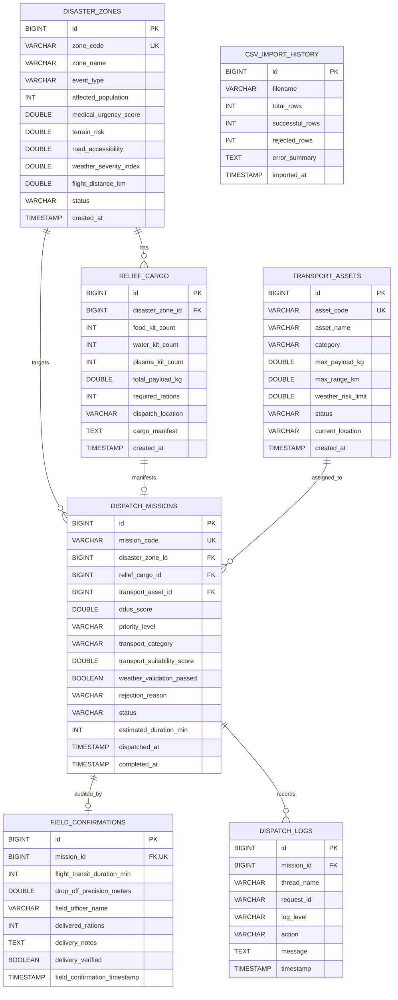

# DATABASE DESIGN SPECIFICATION
## Disaster Relief Supply & Emergency Medical Logistics Dispatch System (DREMLDS)

---

### 1. RELATIONAL ENTITY-RELATIONSHIP ARCHITECTURE

The DREMLDS database (`disaster_relief_db`) utilizes an InnoDB relational schema optimized for high concurrency, ACID transaction guarantees, and analytical telemetry aggregations.

---

### 2. TABLE DEFINITIONS & CONSTRAINTS

1. **`disaster_zones`**:
   - `zone_code`: Unique identifier adhering to `ZONE-[A-Z]{2}-\d{4}` regex.
   - Indexed on `zone_code`, `event_type`, and `status`.

2. **`relief_cargo`**:
   - Links to `disaster_zones(id)` with `ON DELETE CASCADE`.
   - Stores payload weight, required rations, and raw string manifest.

3. **`transport_assets`**:
   - Stores operating ceilings (Helicopters &le; 7.0, Trucks &le; 8.5, Drones &le; 5.0).
   - Atomic reservation state transitions: `AVAILABLE` &rarr; `OCCUPIED` &rarr; `AVAILABLE`.

4. **`dispatch_missions`**:
   - Links zone, cargo, and allocated asset.
   - Tracks operational states: `PENDING`, `DISPATCHED`, `IN_TRANSIT`, `COMPLETED`, `FLIGHT_GROUNDED`, `ABORTED`.

5. **`field_confirmations`**:
   - 1:1 foreign key relation to `dispatch_missions(id)` (`UNIQUE`).
   - Prevents duplicate delivery confirmations.

6. **`dispatch_logs`**:
   - Captures concurrent worker thread diagnostics (`DispatchWorker-1` ... `DispatchWorker-8`).

7. **`csv_import_history`**:
   - Tracks batch file ingestion successes and line-by-line syntax defects.

